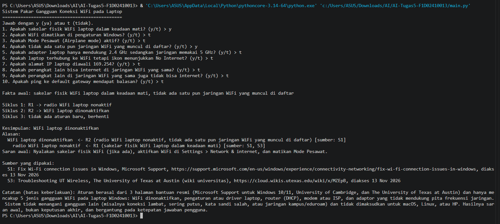
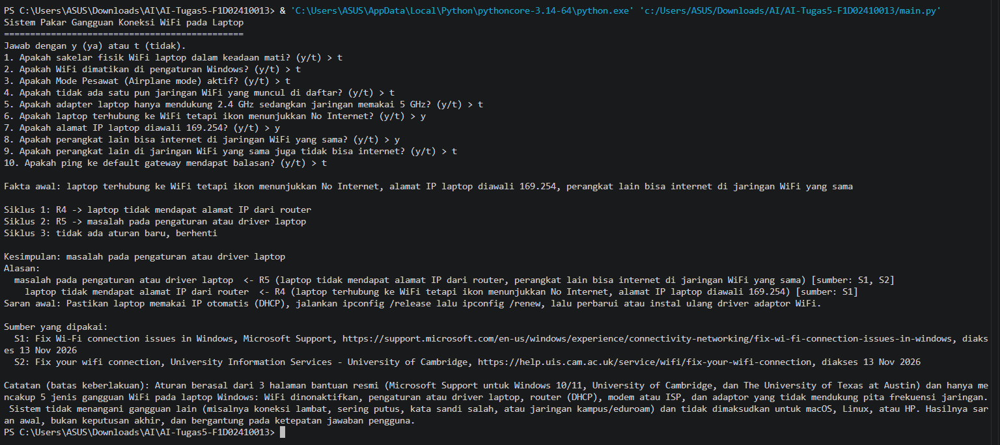
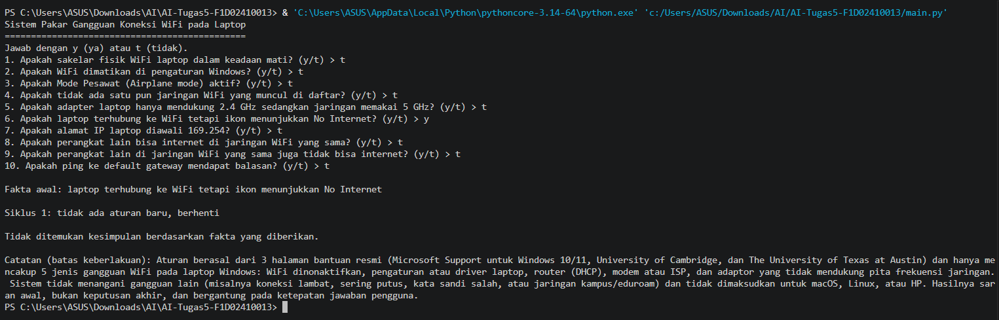

# Sistem Pakar Gangguan Koneksi WiFi pada Laptop

**Nama: M. Alfatih**
**NIM: F1D02410013**
**Mata kuliah: Kecerdasan Buatan**
**Program Studi: Teknik Informatika**

---

## 1. Topik, Deskripsi, dan Tujuan

**Topik:** gangguan koneksi WiFi pada laptop Windows.

**Deskripsi.** Program ini adalah sistem pakar berbasis aturan (rule-based). Pengguna menjawab 10 pertanyaan ya/tidak tentang kondisi WiFi di laptopnya. Jawaban "ya" menjadi fakta awal, lalu mesin inferensi **Forward Chaining** menjalankan aturan IF-THEN dari file `knowledge_base.json` sampai diperoleh kesimpulan. Program menampilkan kesimpulan, alasan (aturan mana yang dipakai), saran awal, sumber, dan batas keberlakuan.

**Tujuan**

1. Memahami cara kerja sistem pakar berbasis aturan: basis pengetahuan, memori kerja, dan mesin inferensi.
2. Mengubah pengetahuan dari sumber resmi di internet menjadi aturan IF-THEN yang bisa dijalankan komputer.
3. Membuat mesin inferensi Forward Chaining sendiri, tanpa library sistem pakar.

---

## 2. Bahasa, Versi, dan Cara Menjalankan

- **Bahasa:** Python 3. Diuji dengan Python 3.13. Versi yang saya pakai: Python 3.14.
- **Library:** hanya modul bawaan Python (`json`, `sys`, `pathlib`). Tidak ada yang perlu di-install.
- **Editor:** Visual Studio Code.

**Menjalankan:**

```bash
# masuk ke folder proyek
cd ai-tugas5-F1D02410013

# Windows
python main.py

# macOS / Linux
python3 main.py
```

Jawab setiap pertanyaan dengan `y` (ya) atau `t` (tidak).

**Struktur folder:**

```
ai-tugas5-NIM/
├── main.py                 # program + mesin inferensi Forward Chaining
├── knowledge_base.json     # basis pengetahuan (aturan, sumber, kesimpulan)
├── README.md
└── screenshot/
    ├── kasus-1.png
    ├── kasus-2.png
    └── kasus-3.png
```

---

## 3. Sumber Referensi

| ID  | Judul                                  | Penerbit                                                 | URL                                                                                                                   | Tanggal akses    |
| --- | -------------------------------------- | -------------------------------------------------------- | --------------------------------------------------------------------------------------------------------------------- | ---------------- |
| S1  | Fix Wi-Fi connection issues in Windows | Microsoft Support (dokumentasi resmi)                    | https://support.microsoft.com/en-us/windows/experience/connectivity-networking/fix-wi-fi-connection-issues-in-windows | 13 November 2026 |
| S2  | Fix your wifi connection               | University Information Services, University of Cambridge | https://help.uis.cam.ac.uk/service/wifi/fix-your-wifi-connection                                                      | 13 November 2026 |
| S3  | Troubleshooting UT Wireless            | The University of Texas at Austin (wiki universitas)     | https://cloud.wikis.utexas.edu/wiki/x/MZEpB                                                                           | 13 November 2026 |

**Pengetahuan yang diambil dari masing-masing sumber**:

- **S1 (Microsoft):**
  - WiFi tidak tersambung bisa karena sakelar fisik WiFi laptop mati, WiFi mati di pengaturan, atau Mode Pesawat aktif.
  - Jika daftar jaringan kosong, salah satu penyebabnya adaptor tidak mendukung frekuensi jaringan (misalnya adaptor hanya 2.4 GHz, jaringan 5 GHz).
  - Jika terhubung tetapi "No Internet" dan alamat IP berbentuk 169.254.x.x, Windows tidak mendapat IP dari router; periksa apakah DHCP aktif di router.
  - Mencoba jaringan yang sama di perangkat lain: jika bisa, masalah kemungkinan ada di laptop.
  - Ping ke default gateway berbalas berarti laptop terhubung ke router, sehingga masalah mungkin di modem atau ISP.
- **S2 (University of Cambridge):**
  - Perangkat harus memakai IP otomatis (DHCP).
  - Perbarui sistem operasi dan driver wireless.
  - Mempersempit masalah dengan membandingkan beberapa perangkat: apakah masalah terjadi di satu perangkat atau banyak perangkat.
- **S3 (UT Austin):** pastikan akses wireless laptop aktif; wireless bisa dimatikan lewat tombol fisik atau lewat pengaturan sistem operasi.

---

## 4. Basis Pengetahuan: Tabel Aturan IF-THEN

Mode `AND` berarti semua syarat harus terpenuhi, `OR` berarti salah satu cukup. Teks dalam huruf miring adalah **fakta antara** (hasil aturan lain, tidak ditanyakan ke pengguna). Teks tebal adalah **kesimpulan akhir**.

| Aturan | IF                                                                                                                              | THEN                                                | Sumber |
| ------ | ------------------------------------------------------------------------------------------------------------------------------- | --------------------------------------------------- | ------ |
| R1     | sakelar fisik WiFi laptop mati **OR** WiFi dimatikan di pengaturan Windows **OR** Mode Pesawat aktif                            | _radio WiFi laptop nonaktif_                        | S1, S3 |
| R2     | _radio WiFi laptop nonaktif_ **AND** tidak ada satu pun jaringan WiFi yang muncul di daftar                                     | **WiFi laptop dinonaktifkan**                       | S1     |
| R3     | tidak ada satu pun jaringan WiFi yang muncul di daftar **AND** adapter hanya mendukung 2.4 GHz sedangkan jaringan memakai 5 GHz | **adapter tidak mendukung pita frekuensi jaringan** | S1     |
| R4     | laptop terhubung ke WiFi tetapi ikon No Internet **AND** alamat IP laptop diawali 169.254                                       | _laptop tidak mendapat alamat IP dari router_       | S1     |
| R5     | _laptop tidak mendapat alamat IP dari router_ **AND** perangkat lain bisa internet di jaringan yang sama                        | **masalah pada pengaturan atau driver laptop**      | S1, S2 |
| R6     | _laptop tidak mendapat alamat IP dari router_ **AND** perangkat lain di jaringan yang sama juga tidak bisa internet             | **masalah pada router (DHCP router)**               | S1, S2 |
| R7     | laptop terhubung ke WiFi tetapi ikon No Internet **AND** ping ke default gateway mendapat balasan                               | **masalah pada modem atau penyedia internet (ISP)** | S1     |

- **Jumlah aturan:** 7 (syarat minimal 5).
- **Jumlah kesimpulan akhir:** 5 (syarat minimal 3): R2, R3, R5, R6, R7.
- **Rantai inferensi:** R1 → R2, R4 → R5, dan R4 → R6. Hasil R1 dan R4 dipakai sebagai syarat aturan berikutnya.

**Catatan jujur tentang R5 dan R6.** Sumber S1 menyebut bahwa alamat 169.254.x.x berarti Windows tidak mendapat IP dari router (periksa DHCP router), dan bahwa jaringan yang bisa dipakai di perangkat lain menunjukkan masalah ada di perangkat. S2 menyarankan membandingkan beberapa perangkat. Menggabungkan kedua petunjuk itu menjadi aturan R5 (perangkat lain normal → masalah di laptop) dan R6 (perangkat lain juga gagal → masalah di router) adalah penalaran saya berdasarkan sumber, bukan kalimat yang tertulis persis seperti itu di sumber.

Aturan disimpan di `knowledge_base.json` dengan format:

```json
{
  "id": "R5",
  "jika": [
    "laptop tidak mendapat alamat IP dari router",
    "perangkat lain bisa internet di jaringan WiFi yang sama"
  ],
  "mode": "dan",
  "maka": "masalah pada pengaturan atau driver laptop",
  "sumber": "S1, S2"
}
```

---

## 5. Metode: Forward Chaining

**Forward Chaining (FC)** adalah penalaran maju yang dimulai dari **fakta** menuju **kesimpulan** (data-driven, bottom-up). Alasan memilih FC:

- Fakta tentang gejala WiFi (ikon, alamat IP, hasil ping) memang tersedia lebih dulu dari pengguna, sedangkan penyebabnya belum diketahui.
- Sistem ini bersifat diagnosis awal dengan banyak kemungkinan penyebab, jadi lebih natural menanyakan gejala lalu melihat aturan mana yang cocok.

**Algoritma yang dipakai** (fungsi `forward_chaining` di `main.py`):

```
memori <- fakta yang dijawab "ya" oleh pengguna
ULANGI:
    cocok <- aturan yang syaratnya terpenuhi oleh memori
             DAN hasilnya (maka) belum ada di memori
    JIKA cocok kosong: BERHENTI
    r <- cocok[0]                 # ambil aturan pertama yang cocok
    tambahkan r.maka ke memori
    catat bahwa r.maka berasal dari r    # bahan untuk "alasan"
```

- Syarat `mode = "dan"` terpenuhi jika semua syarat ada di memori; `mode = "atau"` jika salah satu ada.
- Aturan yang hasilnya sudah ada di memori tidak dijalankan lagi, supaya program tidak berputar tanpa akhir.
- Kriteria berhenti: tidak ada lagi aturan yang cocok.

**Contoh singkat (Kasus 2):** memori awal = {No Internet, IP 169.254, perangkat lain bisa internet}. Siklus 1: R4 cocok → tambah "laptop tidak mendapat IP dari router". Siklus 2: R5 cocok (memakai hasil R4) → tambah kesimpulan. Siklus 3: tidak ada aturan baru → berhenti.

---

## 6. Alur Kerja Program

1. `muat_kb()` membaca `knowledge_base.json`.
2. `cari_fakta_dasar()` mencari fakta yang muncul di bagian IF tetapi tidak pernah menjadi hasil aturan mana pun. Hanya fakta ini yang ditanyakan.
3. `tanya_pengguna()` mengajukan pertanyaan y/t. Jawaban "y" menjadi **fakta awal**.
4. `cari_konflik()` memeriksa jawaban yang saling bertentangan (misalnya "perangkat lain bisa internet" dan "perangkat lain juga tidak bisa internet" sama-sama dijawab ya). Jika ada, program meminta dijalankan ulang.
5. `forward_chaining()` menjalankan siklus inferensi dan mencetak aturan yang dipakai pada tiap siklus.
6. Kesimpulan akhir dipisahkan dari fakta antara memakai daftar `kesimpulan` di JSON.
7. `cetak_alasan()` menelusuri mundur dari kesimpulan: aturan mana yang menghasilkannya, dari syarat apa, dan jika syarat itu hasil aturan lain, ditelusuri lagi.
8. Program menampilkan saran awal, sumber yang dipakai, dan **batas keberlakuan**. Jika tidak ada kesimpulan, program menampilkan "Tidak ditemukan kesimpulan berdasarkan fakta yang diberikan."

---

## 7. Tiga Kasus Uji

Hasil di bawah adalah keluaran asli program (`python main.py`). Pertanyaan diberi nomor sesuai urutan di program:

| No  | Pertanyaan                                                       |
| --- | ---------------------------------------------------------------- |
| 1   | sakelar fisik WiFi laptop dalam keadaan mati                     |
| 2   | WiFi dimatikan di pengaturan Windows                             |
| 3   | Mode Pesawat aktif                                               |
| 4   | tidak ada satu pun jaringan WiFi yang muncul di daftar           |
| 5   | adapter hanya mendukung 2.4 GHz sedangkan jaringan memakai 5 GHz |
| 6   | laptop terhubung ke WiFi tetapi ikon No Internet                 |
| 7   | alamat IP laptop diawali 169.254                                 |
| 8   | perangkat lain bisa internet di jaringan yang sama               |
| 9   | perangkat lain di jaringan yang sama juga tidak bisa internet    |
| 10  | ping ke default gateway mendapat balasan                         |

### Kasus 1: menghasilkan kesimpulan gangguan tertentu

- **Jawaban "ya":** nomor 1 dan 4. Lainnya "tidak".
- **Hasil yang diharapkan:** _WiFi laptop dinonaktifkan_ (R1 lalu R2).

```
Fakta awal: sakelar fisik WiFi laptop dalam keadaan mati, tidak ada satu pun jaringan WiFi yang muncul di daftar

Siklus 1: R1 -> radio WiFi laptop nonaktif
Siklus 2: R2 -> WiFi laptop dinonaktifkan
Siklus 3: tidak ada aturan baru, berhenti

Kesimpulan: WiFi laptop dinonaktifkan
Alasan:
  WiFi laptop dinonaktifkan  <- R2 (radio WiFi laptop nonaktif, tidak ada satu pun jaringan WiFi yang muncul di daftar) [sumber: S1]
    radio WiFi laptop nonaktif  <- R1 (sakelar fisik WiFi laptop dalam keadaan mati) [sumber: S1, S3]
Saran awal: Nyalakan sakelar fisik WiFi (jika ada), aktifkan WiFi di Settings > Network & internet, dan matikan Mode Pesawat.
```



### Kasus 2: menghasilkan kesimpulan yang berbeda

- **Jawaban "ya":** nomor 6, 7, dan 8. Lainnya "tidak".
- **Hasil yang diharapkan:** _masalah pada pengaturan atau driver laptop_ (R4 lalu R5).

```
Fakta awal: laptop terhubung ke WiFi tetapi ikon menunjukkan No Internet, alamat IP laptop diawali 169.254, perangkat lain bisa internet di jaringan WiFi yang sama

Siklus 1: R4 -> laptop tidak mendapat alamat IP dari router
Siklus 2: R5 -> masalah pada pengaturan atau driver laptop
Siklus 3: tidak ada aturan baru, berhenti

Kesimpulan: masalah pada pengaturan atau driver laptop
Alasan:
  masalah pada pengaturan atau driver laptop  <- R5 (laptop tidak mendapat alamat IP dari router, perangkat lain bisa internet di jaringan WiFi yang sama) [sumber: S1, S2]
    laptop tidak mendapat alamat IP dari router  <- R4 (laptop terhubung ke WiFi tetapi ikon menunjukkan No Internet, alamat IP laptop diawali 169.254) [sumber: S1]
Saran awal: Pastikan laptop memakai IP otomatis (DHCP), jalankan ipconfig /release lalu ipconfig /renew, lalu perbarui atau instal ulang driver adaptor WiFi.
```



### Kasus 3: tidak menghasilkan kesimpulan

- **Jawaban "ya":** hanya nomor 6. Lainnya "tidak".
- **Hasil yang diharapkan:** tidak ada kesimpulan. R4 butuh IP 169.254 dan R7 butuh ping berbalas, keduanya dijawab "tidak", jadi tidak ada aturan yang terpenuhi.

```
Fakta awal: laptop terhubung ke WiFi tetapi ikon menunjukkan No Internet

Siklus 1: tidak ada aturan baru, berhenti

Tidak ditemukan kesimpulan berdasarkan fakta yang diberikan.
```



### Uji tambahan (semua kesimpulan dan kasus tepi)

Hasil berikut juga berasal dari menjalankan program.

| Jawaban "ya" (nomor) | Hasil                                                       |
| -------------------- | ----------------------------------------------------------- |
| 6, 7, 9              | R4 → R6: _masalah pada router (DHCP router)_                |
| 6, 10                | R7: _masalah pada modem atau penyedia internet (ISP)_       |
| 4, 5                 | R3: _adapter tidak mendukung pita frekuensi jaringan_       |
| 6, 7                 | R4 saja: hanya fakta antara, **tidak ada kesimpulan akhir** |
| 8, 9                 | Program menolak: jawaban saling bertentangan                |

---

## 8. Batas Keberlakuan Sistem Pakar

Pengetahuan dalam sistem ini berasal dari tiga halaman bantuan resmi, yaitu dokumentasi Microsoft Support untuk Windows 10/11, halaman bantuan IT University of Cambridge, dan wiki University of Texas at Austin, sehingga yang direpresentasikan adalah panduan umum penyedia perangkat lunak dan institusi tersebut, bukan pengetahuan seorang teknisi jaringan tertentu. Sistem hanya berlaku untuk laptop Windows yang mengalami salah satu dari lima gangguan yang tercakup (WiFi dinonaktifkan, pengaturan atau driver laptop, router/DHCP, modem atau ISP, dan adaptor yang tidak mendukung pita frekuensi), dan tidak menangani gangguan lain seperti koneksi lambat, sering putus, kata sandi salah, jaringan kampus (eduroam), macOS, Linux, atau HP. Aturan memakai jawaban ya/tidak sehingga hasilnya sangat bergantung pada ketepatan jawaban pengguna; "tidak ada kesimpulan" tidak berarti WiFi tidak bermasalah, hanya berarti fakta yang diberikan tidak cocok dengan aturan yang ada. Hasilnya adalah saran awal, bukan keputusan akhir; untuk masalah yang berlanjut, hubungi teknisi atau penyedia internet.

---

## 9. Penggunaan AI sebagai Alat Bantu

Saya menggunakan Claude sebagai alat bantu dalam mengerjakan tugas ini, yaitu untuk mencari dan memeriksa sumber, dan membantu saya mempelajari aturan atau kode sehingga saya dapat memahami isi, kode, dan cara kerja Forward Chaining pada program ini.
